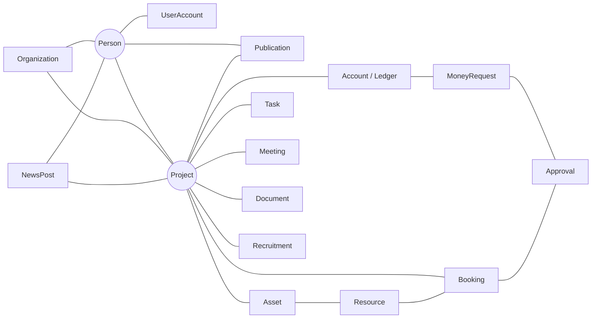
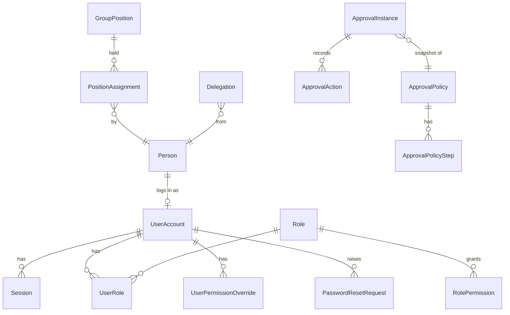
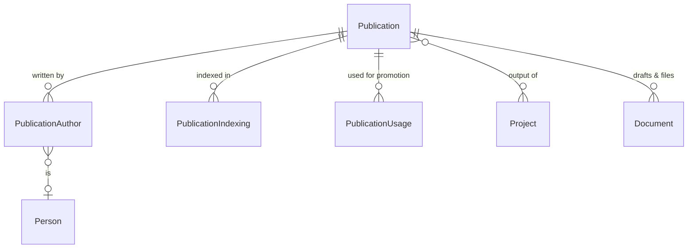
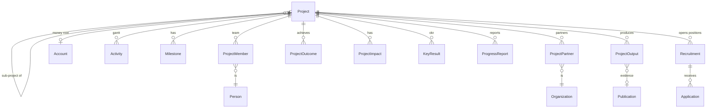
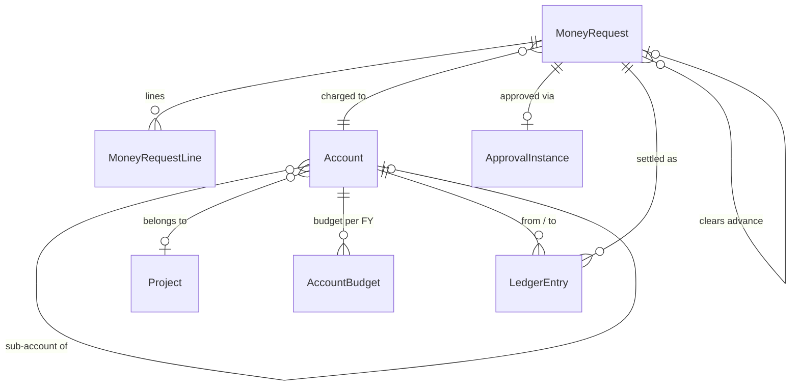
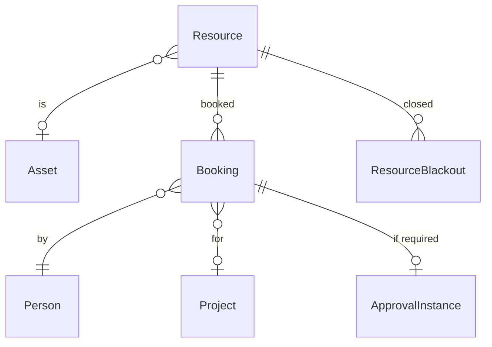

# MECMAT — แบบจำลองข้อมูลทั้งระบบ (ร่างสำหรับเจ้าของตรวจ)

สถานะ: **ร่าง ขั้น A** ยังไม่มีโค้ด เจ้าของตรวจเอกสารนี้ก่อนเริ่มเขียน migration แรก
เอกสารที่เกี่ยวข้อง: [authorization.md](authorization.md) · [adr/](adr/)

## หลักร่วมของทุกตาราง

| หลัก | รายละเอียด |
|---|---|
| รหัส (Id) | สตริงที่เซิร์ฟเวอร์สร้างให้ รูปแบบ `PFX-YYMMDD-####` เช่น `PER-261028-0001` ห้ามตั้งเอง (แนวคิดเดียวกับ ERP) |
| ฟิลด์ฐาน | `Id, RecordStatus (Active/Archived/Deleted), CreatedAt, CreatedBy, ModifiedAt, ModifiedBy, SyncStamp` |
| ลบ | soft delete เท่านั้น (`RecordStatus=Deleted`) ยกเว้นตาราง log |
| Concurrency | `SyncStamp` ไม่ตรงกันจะได้ 409 ระบบไม่เขียนทับงานของคนอื่นแบบเงียบ ๆ |
| Enum | เก็บเป็นข้อความ (`HasConversion<string>()`) ทำให้อ่านฐานข้อมูลตรง ๆ ได้ และเพิ่มค่าใหม่ได้โดยไม่ต้องย้ายข้อมูล |
| เงิน | `long` หน่วยสตางค์ (ADR 0004) |
| วันที่ | `DateOnly` สำหรับวันที่ (เก็บเป็น ค.ศ. แสดงเป็น พ.ศ. ในโหมดไทย) ส่วนเวลาใช้ `DateTimeOffset` UTC แสดงตามเวลา Asia/Bangkok |
| สองภาษา | ฟิลด์ที่แสดงบนหน้าสาธารณะมีคู่ `…Th` / `…En` ถ้าไม่มีภาษาอังกฤษ หน้า EN จะใช้ภาษาไทยแทน |
| Audit | การเปลี่ยนสถานะทุกครั้งลง `ChangeLog` ใน transaction เดียวกับการแก้ไข |
| Published | ตารางที่แสดงบนหน้าสาธารณะได้มี `IsPublic` หรือ `Status=Published` |

Prefix ของรหัส: PER บุคคล, ORG องค์กร, USR บัญชี, PUB ผลงาน, PRJ โครงการ, ACC บัญชีเงิน, LED รายการบัญชี, REQ คำขอเงิน, AST ครุภัณฑ์, MAT วัสดุ, RES ทรัพยากรจอง, BKG การจอง, TSK งาน, MTG ประชุม/นัดหมาย, DOC เอกสาร, NEW ข่าว, APL ใบสมัคร, MSG ข้อความติดต่อ

---

## ภาพรวม: ข้อมูลทุกส่วนเชื่อมกันที่ Person และ Project



---

## M1 บุคคลและองค์กร

```mermaid
erDiagram
  Person ||--o{ PersonEducation : has
  Person ||--o{ PersonEmployment : has
  Person ||--o{ AcademicAppointment : has
  Person ||--o{ TeachingRecord : has
  Person ||--o{ ProfessionalLicense : has
  Person ||--o{ PayoutChannel : has
  Person ||--o{ PublicFieldVisibility : chooses
  Person }o--o| Organization : "affiliated with"
  Person }o--o| Person : "advisor of"
  Organization }o--o| Organization : parent
  Award ||--o{ AwardRecipient : to
  AwardRecipient }o--|| Person : is
  Person }o--o{ ResearchArea : tagged
```

### Person — บุคลากรภายในและภายนอก
| ฟิลด์ | ชนิด | หมายเหตุ / ที่มา |
|---|---|---|
| Kind | enum | `Internal` / `External` |
| Category | enum | Faculty (อาจารย์), Researcher, Postdoc, ResearchAssistant, PhdStudent, MasterStudent, BachelorStudent, Intern, Staff, Visiting, IndustryPartner, Collaborator, Sponsor |
| TitleTh / TitleEn | text | นาย/นาง/นางสาว, Mr./Ms. |
| AcademicRank | enum | None, AsstProf (ผศ.), AssocProf (รศ.), Prof (ศ.) — ตามตำแหน่งล่าสุดใน AcademicAppointment |
| HasDoctorate | bool | ถ้าเป็นจริงจะแสดงคำนำหน้า "ดร." |
| FirstNameTh, LastNameTh, FirstNameEn, LastNameEn, Nickname | text | |
| DateOfBirth | date | ก.พ.อ.03 ส่วนที่ 1 · **ห้ามแสดงสาธารณะ** |
| NationalId | text, เข้ารหัส | **ห้ามแสดงสาธารณะ** (ADR 0007) |
| WorkEmail, PersonalEmail, WorkPhone, MobilePhone, LineId, OfficeRoom | text | MobilePhone ห้ามแสดงสาธารณะ |
| PhotoFileId | → FileBlob | |
| OrganizationId | → Organization | สังกัดหลัก (จำเป็นสำหรับบุคคลภายนอก) |
| PositionText | text | ตำแหน่งงาน เช่น "อาจารย์", "Senior Engineer" |
| AdvisorPersonId | → Person | อาจารย์ที่ปรึกษาของนักศึกษา |
| StudentId, ProgramName, EnrolledYear, ExpectedGraduation | | สำหรับนักศึกษา |
| ExpertiseTh / ExpertiseEn | text | คำสำคัญคั่นด้วยจุลภาค |
| BioTh / BioEn | rich text | |
| OrcidId, ScopusAuthorId, GoogleScholarId, ResearcherId, ResearchGateUrl, WebsiteUrl | text | ดึงผลงานได้ภายหลัง |
| JoinedDate, LeftDate | date | วันเข้าและออกจากกลุ่ม |
| PublicSlug | text unique | URL หน้าโปรไฟล์ เช่น `/people/kasan-chanto` |
| DisplayOrder | int | ลำดับบนหน้าบุคลากร |

### PersonEducation — ประวัติการศึกษา (ก.พ.อ.03: เรียงจากวุฒิสูงสุด)
`PersonId, Level (Bachelor/Master/Doctoral/Diploma/Certificate/Exchange/Other), DegreeNameTh (วศ.บ.), DegreeNameEn (B.Eng.), Field, Institution, Country, StartYear, GraduatedYear (ค.ศ.), Honors (เกียรตินิยม), ThesisTitle, IsPublic`

### PersonEmployment — ประวัติการทำงาน
`PersonId, OrganizationId / OrganizationText, Position, StartDate, EndDate (null = ปัจจุบัน), Description, IsPublic`

### AcademicAppointment — ตำแหน่งทางวิชาการ (ก.พ.อ.)
`PersonId, Rank, FieldName (สาขาวิชา), FieldCode (รหัสสาขาตามประกาศ ก.พ.อ. 2562), SubField, Method (1/2/3), AppointedDate, ReferenceText`

### TeachingRecord — ภาระงานสอน (ก.พ.อ.03 ภาระงาน 3 ปี)
`PersonId, AcademicYear, Semester, Level (ป.ตรี/โท/เอก), CourseCode, CourseName, Credits, HoursPerWeek, ResponsibilityPct`

### ProfessionalLicense — ใบอนุญาต (เช่น กว.)
`PersonId, Body (สภาวิศวกร ฯลฯ), Level (ภาคี/สามัญ/วุฒิ), Branch (โยธา), LicenseNo, IssuedDate, ExpiryDate, IsPublic`

### PayoutChannel — ช่องทางรับเงิน (เข้ารหัส)
`PersonId, Kind (BankAccount/PromptPay), BankName, AccountNo*, AccountName, PromptPayId*, IsPrimary` (* = เข้ารหัส)

### PublicFieldVisibility — ผู้ใช้เลือกว่าจะแสดงอะไรบนเว็บ
`PersonId, FieldKey, IsPublic`
- FieldKey ที่เลือกได้: photo, positionText, academicRank, workEmail, workPhone, officeRoom, lineId, expertise, bio, orcid, scopus, scholar, researchgate, website, education, employment, licenses, awards, publications, projects
- ฟิลด์ต้องห้าม (NationalId, DateOfBirth, PayoutChannel, MobilePhone, PersonalEmail) **ไม่มี key ให้เลือก**

### Organization — องค์กรภายนอกและภายใน
`NameTh, NameEn, ShortName, Kind (University/Faculty/Department/Company/Government/FundingAgency/NGO/Other), ParentOrganizationId, Country, Address, Website, Phone, LogoFileId, Notes, IsPublic (แสดงในหน้าพันธมิตร)`

### Award / AwardRecipient — รางวัล
- Award: `TitleTh/En, Issuer, Date, Level (International/National/Institutional), Description, ProjectId?, PublicationId?, IsPublic`
- AwardRecipient: `AwardId, PersonId`

### ResearchArea — สาขาวิจัย (หน้าสาธารณะ)
`NameTh/En, SummaryTh/En, CoverFileId, DisplayOrder` และมีตารางเชื่อม `PersonResearchArea`, `ProjectResearchArea`, `PublicationResearchArea`

---

## M2 บัญชีผู้ใช้ สิทธิ์ และโครงสร้างอำนาจ



| ตาราง | ฟิลด์หลัก |
|---|---|
| **UserAccount** | `PersonId (unique), Username, PasswordHash, PasswordChangedAt, MustChangePassword, Status (PendingApproval/Active/Suspended/Expired/Closed), ExpiresAt (บัญชีขาจร), TotpSecret*, TotpEnabled, RecoveryCodesHash, FailedLoginCount, LockedUntil, LastLoginAt, Language (th/en), Theme (light/dark/auto), IsAdmin` |
| **Session** | `TokenHash (SHA-256), UserId, CsrfTokenHash, CreatedAt, LastSeenAt, IdleExpiresAt, AbsoluteExpiresAt, IpHash, UserAgent, RevokedAt, RevokeReason` |
| **PasswordResetRequest** | `UserId หรือ UsernameTyped, RequestedAt, Status (Open/Done/Rejected), HandledBy, HandledAt, Note` |
| **Role** | `Name (Admin, GroupHead, Faculty, Researcher, FinanceOfficer, LabManager, Student, External, Transient), Description, IsSystem` |
| **RolePermission** | `RoleId, Module, Action (None/View/Create/Edit/Manage), Scope (Related/All)` — รายละเอียดใน authorization.md |
| **UserPermissionOverride** | `UserId, Module, Action, Scope, Reason` — ใช้กำหนดสิทธิ์เฉพาะบุคคลได้ |
| **GroupPosition** | `NameTh/En (หัวหน้ากลุ่มวิจัย, รองหัวหน้า, ผู้จัดการการเงิน, เลขานุการกลุ่ม, ผู้ดูแลห้องปฏิบัติการ …), Rank (ใช้เรียงอำนาจ), IsPublic` |
| **PositionAssignment** | `PositionId, PersonId, FromDate, ToDate` |
| **ApprovalPolicy** | `Name, SubjectType (MoneyRequest/Booking/AccountSignup …), RequestKind?, MinAmount, MaxAmount, AccountScopeId? (ครอบคลุมบัญชีลูก), ProjectScopeId?, Priority, IsActive` |
| **ApprovalPolicyStep** | `PolicyId, StepOrder, ApproverKind (Position/Person/ProjectRole/AccountCustodian/RequesterAdvisor/ResourceManager), ApproverRef, Rule (Any/All)` |
| **ApprovalInstance** | `SubjectType, SubjectId, PolicySnapshotJson, Status (Pending/Approved/Rejected/Returned/Cancelled), CurrentStep, SubmittedAt, ClosedAt` |
| **ApprovalAction** | `InstanceId, StepOrder, ActorPersonId, OnBehalfOfPersonId?, Decision (Approve/Reject/Return/Comment), Comment, At` |
| **Delegation** | `FromPersonId, ToPersonId, FromDate, ToDate, SubjectType? (null = ทุกเรื่อง), Reason` |

---

## M3 ผลงานวิจัยและผลงานตีพิมพ์ (ตามเกณฑ์ ก.พ.อ. 2564 และฉบับที่ 3/2568)



### Publication
| ฟิลด์ | หมายเหตุ |
|---|---|
| Type | JournalArticle, ConferencePaper, BookChapter, Book, Textbook (ตำรา), AcademicArticle (บทความวิชาการ), TeachingMaterial (เอกสารประกอบการสอน/คำสอน), ResearchReport, SocialServiceWork (ผลงานรับใช้ท้องถิ่นและสังคม), Patent, PettyPatent (อนุสิทธิบัตร), Software, IndustryWork (ผลงานวิชาการเพื่ออุตสาหกรรม), CreativeWork, Thesis, Other |
| Stage | Idea, Drafting, Submitted, UnderReview, Revision, Accepted, Published, Rejected, Withdrawn — ใช้ติดตามงานที่กำลังเขียนด้วย |
| TitleEn, TitleTh, AbstractEn, AbstractTh, Keywords | |
| VenueName, VenueKind (Journal/Conference/Publisher/Office) | |
| Volume, Issue, Pages, ArticleNumber, Year, PublishedDate | |
| Doi, Url, Issn, Isbn, Publisher, Edition, ConferenceLocation, ConferenceDates | |
| CitationCount, CitationAsOf | |
| ApaCitation | ระบบสร้างให้อัตโนมัติ และแก้เองได้ (ก.พ.อ.03 ให้อ้างอิงแบบ APA) |
| PatentApplicationNo, PatentNo, FiledDate, GrantedDate, PatentCountry | สำหรับสิทธิบัตรและอนุสิทธิบัตร |
| CourseCode, CourseName, Credits | สำหรับเอกสารประกอบการสอน |
| SocialStageA/B/C | bool: บทบาทในขั้นวิเคราะห์ / ออกแบบ / ประเมินผล ของผลงานรับใช้สังคม (ก.พ.อ. ต้องมีอย่างน้อย 3 ขั้น) |
| FromThesisOfPersonId | ผลงานที่มาจากวิทยานิพนธ์ของนักศึกษา |
| IsPublic | |

### PublicationAuthor — บทบาทผู้แต่งตาม ก.พ.อ.
`PublicationId, Order, PersonId? หรือ ExternalName + ExternalAffiliation, IsFirstAuthor, IsCorresponding, IsEssentialContributor (ผู้มีส่วนสำคัญทางปัญญา), ContributionDescription, ContributionPct?, CertifiedAt?, CertificationFileId?, IsStudentAtTime`
- เกณฑ์ปัจจุบันใช้บทบาทเป็นหลัก ไม่ได้ใช้ % ช่อง `ContributionPct` จึงไม่บังคับ
- เมื่อมี `CertifiedAt` (แบบแสดงหลักฐานการมีส่วนร่วมลงนามแล้ว) ระบบจะล็อกแถวนั้น ไม่ให้แก้ไข

### PublicationIndexing
`PublicationId, Database (Scopus/WoS/TCI1/TCI2/PubMed/ACI/Other), Quartile (Q1–Q4), ImpactFactor, SjrYear, Note`

### PublicationUsage — การใช้ผลงานขอตำแหน่ง
`PublicationId, PersonId, ForRank (ผศ./รศ./ศ.), Year, QualityResult, Note` (ก.พ.อ.03 ให้ระบุว่าเคยใช้ผลงานนี้ขอตำแหน่งแล้วหรือยัง)

### การนำเข้าข้อมูล
- กรอก DOI แล้วระบบดึงข้อมูลจาก Crossref (`api.crossref.org` ฟรี ไม่ต้องใช้ key) มาเติมฟอร์ม ผู้ใช้ตรวจก่อนบันทึก
- การดึงข้อมูลจาก ORCID จะทำในรอบถัดไป

---

## M4 โครงการวิจัย (ตามโครงสร้าง NRIIS / สกสว.)



### Project
| ฟิลด์ | หมายเหตุ |
|---|---|
| Code | รหัสภายใน และ `ExternalCode` สำหรับรหัสของแหล่งทุนหรือรหัส NRIIS |
| Kind | Program (แผนงาน/ชุดโครงการ), Project (โครงการเดี่ยว), SubProject (โครงการย่อย), AcademicService (บริการวิชาการ), Consulting (ที่ปรึกษา), Internal (ภายในกลุ่ม) |
| ParentProjectId | ใช้กับโครงการย่อย |
| TitleTh, TitleEn, KeywordsTh, KeywordsEn | ไม่เกิน 5 คำต่อภาษา (ตามแบบฟอร์ม สกสว.) |
| Summary, Rationale, Objectives, Framework, Methodology | rich text |
| Status | Idea, Drafting, Submitted, UnderReview, Funded, Active, Extended, Completed, Closed, Rejected, Cancelled |
| FunderOrganizationId, FundingScheme, ContractNo, FiscalYear | |
| StartDate, EndDate, ExtendedEndDate | |
| TotalBudget | สตางค์ เป็นงบตามสัญญา ส่วนรายละเอียดตามหมวดอยู่ที่ Account |
| InstitutionFeePct | ค่าธรรมเนียมอุดหนุนสถาบัน (%) |
| TrlStart, TrlTarget, TrlCurrent, SrlStart, SrlTarget, SrlCurrent | ระดับ 1–9 พร้อมคำอธิบาย |
| ResearchAreaIds | ผ่านตารางเชื่อม |
| ResearchSite, BeneficiaryArea | พื้นที่วิจัยและพื้นที่ได้รับประโยชน์ |
| IsPublic, PublicSummaryTh/En, CoverFileId | |

| ตาราง | ฟิลด์ |
|---|---|
| **ProjectMember** | `ProjectId, PersonId, Role (PI/CoPI/Researcher/ResearchAssistant/Student/Consultant/IndustryPartner/Coordinator/FinanceContact), EffortPct, FromDate, ToDate, IsPublic` |
| **ProjectPartner** | `ProjectId, OrganizationId, Role (Funder/CoFunder/Industry/Collaborator/Beneficiary), InCashAmount, InKindAmount, InKindDescription` |
| **Activity** (Gantt) | `ProjectId, ParentActivityId, Name, StartDate, EndDate, ProgressPct, WeightPct, OwnerPersonId, Deliverable, DependsOnActivityId, Order` |
| **Milestone** | `ProjectId, Name, DueDate, Status (Pending/Done/Late/Waived), DoneDate, Note` |
| **ProjectOutput** | `ProjectId, OutputType, Description, TargetQty, Unit, ActualQty, AchievedDate, LinkedType (Publication/Asset/Document/Person/Organization), LinkedId` |
| **ProjectOutcome** | `ProjectId, OutcomeType (Publication/Citation/Tool/Database/NextDestination/Award/FacilityUse/IpLicensing/Other), Description, Evidence, Date` |
| **ProjectImpact** | `ProjectId, Dimension (Academic/Social/Economic/Environmental/Policy), Description, Indicator, Value, Unit` |
| **KeyResult** (OKR) | `ProjectId?, Objective, KeyResultText, Target, Actual, Unit, Period` (ไม่ผูกโครงการ = OKR ของทั้งกลุ่ม) |
| **ProgressReport** | `ProjectId, Kind (Progress/Annual/Final/Financial/Other), PeriodNo, PeriodFrom, PeriodTo, DueDate, SubmittedDate, Status (Upcoming/Due/Submitted/Accepted/Revise), Summary, FileId?` — ใช้ติดตามเท่านั้น ไม่สร้างเอกสาร |
| **Recruitment** | `ProjectId?, TitleTh/En, PositionType (ResearchAssistant/MasterStudent/PhdStudent/Postdoc/Intern/Engineer/Other), DescriptionTh/En, Qualifications, CompensationText, Seats, OpenDate, CloseDate, Status (Draft/Open/Closed/Filled), IsPublic` |
| **Application** | `RecruitmentId, FullName, Email, Phone, Message, CvFileId, ConsentRecordId, Status (New/Shortlisted/Interview/Offered/Accepted/Rejected/Withdrawn), ReviewerNotes, SubmittedAt, IpHash` |

**OutputType 10 ประเภท (ตาม สกสว.)**: Manpower (กำลังคน/หน่วยงานที่ได้รับการพัฒนา), Manuscript (ต้นฉบับบทความ), Book (หนังสือ), Prototype (ต้นแบบผลิตภัณฑ์/เทคโนโลยี/กระบวนการ/นวัตกรรมทางสังคม), IntellectualProperty (ทรัพย์สินทางปัญญา), Infrastructure (เครื่องมือและโครงสร้างพื้นฐาน), DatabaseSystem (ฐานข้อมูล/ระบบ/กลไก/มาตรฐาน), Network (เครือข่าย), Investment (การลงทุนวิจัยและนวัตกรรม ทั้งตัวเงินและไม่ใช่ตัวเงิน), PolicyRecommendation (ข้อเสนอแนะเชิงนโยบาย)

---

## M5 การเงินเชิงตัวเลข (ADR 0004)



| ตาราง | ฟิลด์ |
|---|---|
| **Account** | `Code, NameTh/En, ParentAccountId, Kind (FundingSource/Project/BudgetCategory/Wallet/Other), ProjectId?, BudgetCategory? (Compensation ค่าตอบแทน/ค่าจ้าง · Operating ค่าใช้สอย · Materials ค่าวัสดุ · Equipment ค่าครุภัณฑ์ · InstitutionFee ค่าธรรมเนียมอุดหนุนสถาบัน · Other), CustodianPersonId, AllowNegative, IsLeaf (คำนวณ), Description` |
| **AccountBudget** | `AccountId, FiscalYear, Amount, Note` |
| **LedgerEntry** (แก้ไขไม่ได้) | `EntryDate, Kind (Income/Transfer/Expense/AdvanceOut/AdvanceReturn/AdvanceClear/Adjustment/Reversal), FromAccountId?, ToAccountId?, Amount (>0), Description, CounterpartyPersonId?, CounterpartyOrganizationId?, CounterpartyText?, MoneyRequestId?, ReversesEntryId?, BudgetCategory, ReferenceText (เลขที่หลักฐานภายนอก)` |
| **MoneyRequest** | `Kind (Reimbursement ขอเบิก / Payment ขอจ่าย / Advance ขอยืม / AdvanceClearance ล้างเงินยืม / Transfer ขอโอน), RequesterPersonId, AccountId, ToAccountId? (สำหรับ Transfer), ProjectId?, Purpose, PayeePersonId?/PayeeOrganizationId?/PayeeText?, TotalAmount (= ผลรวมรายการย่อย), NeededBy, AdvanceDueDate?, RelatedAdvanceId?, Status (Draft/Submitted/InApproval/Approved/Rejected/Returned/Cancelled/Settled), ApprovalInstanceId, SettledAt, SettledBy` |
| **MoneyRequestLine** | `RequestId, Description, Qty, UnitPrice, Amount, BudgetCategory` |
| **Attachment** | (ใช้ร่วมทุกโมดูล) `OwnerType, OwnerId, FileBlobId, Label` — หลักฐานประกอบคำขอ |

**กติกาที่เซิร์ฟเวอร์บังคับ**
1. ลงบัญชีได้เฉพาะบัญชีปลายสุด (leaf)
2. ยอดใช้ได้ = คงเหลือ − คำขอที่อนุมัติแล้วแต่ยังไม่ลงบัญชี − คำขอที่รออนุมัติ ห้ามติดลบ
3. คำขอสถานะ Approved จึงจะ Settle ได้ การ Settle สร้าง LedgerEntry และผู้ Settle ต้องมีสิทธิ์ Finance:Edit
4. เงินยืม: ยอดค้าง = ยืม − ล้าง − คืน ระบบเตือนก่อนครบกำหนด 3 วัน และทุกวันเมื่อเลยกำหนด
5. บัญชีที่มีรายการแล้วลบไม่ได้ ทำได้เพียงปิด (Archived)

---

## M6 ครุภัณฑ์ วัสดุ และเครื่องมือ

| ตาราง | ฟิลด์ |
|---|---|
| **Asset** | `AssetCode (รหัสครุภัณฑ์ของมหาวิทยาลัย), InternalCode, NameTh/En, Category, Brand, Model, SerialNo, AcquiredDate, AcquisitionMethod (Purchase/Donation/Transfer/BuiltInHouse), FundingProjectId?, FundingAccountId?, Cost, VendorOrganizationId?, ReferenceNo (สัญญา/ใบส่งของ), Location, CustodianPersonId, UsefulLifeYears, SalvageValue, Status (InUse/OnLoan/UnderRepair/Broken/Disposed/Lost), DisposedDate, DisposalMethod, PhotoFileIds, Specifications, IsPublic (แสดงในหน้าเครื่องมือของกลุ่ม)` |
| **AssetLoan** | `AssetId, BorrowerPersonId, ProjectId?, FromDate, DueDate, ReturnedDate, ConditionOut, ConditionIn` |
| **Maintenance** | `AssetId, Date, Kind (Calibration/Repair/Preventive/Inspection), Description, Cost, VendorOrganizationId?, NextDueDate, CertificateFileId?` |
| **Material** | `Code, NameTh/En, Category, Unit, MinStock, Location, Note` |
| **MaterialMovement** | `MaterialId, Date, Kind (In/Out/Adjust), Qty, UnitCost?, ProjectId?, PersonId, Note` — ยอดคงคลังคำนวณจากรายการเหล่านี้ |

- รายการที่ราคาต่อหน่วยตั้งแต่ **10,000 บาท** ขึ้นไปเป็นครุภัณฑ์ ต่ำกว่านั้นเป็น "วัสดุคงทน/ทะเบียนคุม" (`AssetClass` คำนวณจาก Cost)
- **ค่าเสื่อมราคา**ใช้วิธีเส้นตรง คำนวณตอนแสดงผลจาก Cost, SalvageValue, UsefulLifeYears และ AcquiredDate ไม่เก็บซ้ำ จึงไม่มีตัวเลขที่ค้างเก่า

---

## M7 ระบบจอง (ปฏิทิน + เวลา)



| ตาราง | ฟิลด์ |
|---|---|
| **Resource** | `NameTh/En, Kind (Equipment/Room/Vehicle/Other), AssetId?, Location, Description, ManagerPersonId, RequiresApproval, SlotMinutes (ค่าเริ่มต้น 30), MinDurationMinutes, MaxDurationMinutes, MaxAdvanceDays, OpenHoursJson (เวลาเปิดรายวันจันทร์–อาทิตย์), AllowedRoles, Color, IsActive` |
| **Booking** | `ResourceId, BookerPersonId, ProjectId?, Title, StartAt, EndAt, Status (Pending/Confirmed/Rejected/Cancelled/Completed/NoShow), Note, RecurrenceGroupId?, ApprovalInstanceId?, CancelledReason` |
| **ResourceBlackout** | `ResourceId, StartAt, EndAt, Reason` (ปิดซ่อม วันหยุด) |

- **กันจองซ้อนที่เซิร์ฟเวอร์**: ภายใน transaction เดียว ตรวจว่าไม่มี Booking ที่เป็น Pending หรือ Confirmed ทับช่วงเวลา และไม่มี Blackout ทับ
- มุมมองมีแบบวัน สัปดาห์ เดือน และไทม์ไลน์ (ทรัพยากรเป็นแถว เวลาเป็นคอลัมน์)
- จองซ้ำได้ (ทุกสัปดาห์ ไม่เกิน 26 ครั้ง) ระบบสร้างเป็นรายการแยกกันและผูกด้วย RecurrenceGroupId

---

## M8 งาน นัดหมาย และบันทึกการประชุม

| ตาราง | ฟิลด์ |
|---|---|
| **TaskItem** | `Title, Description, ProjectId?, ActivityId?, ParentTaskId?, CreatorPersonId, Status (Todo/InProgress/Review/Done/Cancelled), Priority (Low/Normal/High/Urgent), StartDate, DueDate, CompletedAt, Tags, SourceMeetingId?` |
| **TaskAssignee** | `TaskId, PersonId` |
| **TaskComment** | `TaskId, AuthorPersonId, Body, At` |
| **Meeting** | `Title, Kind (Meeting/Appointment/Seminar/ThesisDefense/SiteVisit/Other), StartAt, EndAt, Location, OnlineUrl, ProjectId?, OrganizerPersonId, Agenda, Status (Scheduled/Done/Cancelled), Visibility (Attendees/Group)` |
| **MeetingAttendee** | `MeetingId, PersonId? หรือ ExternalName, Response (Pending/Accepted/Declined/Tentative), Attended` |
| **MeetingMinutes** | `MeetingId, Body (rich text), RecordedByPersonId, ConfirmedAt?` |
| **ActionItem** → TaskItem | action item ในบันทึกประชุมจะกลายเป็น TaskItem (`SourceMeetingId`) ทำให้ติดตามต่อในบอร์ดงานได้ |

**ปฏิทินรวม** (อ่านอย่างเดียว) ดึงข้อมูลจาก Meeting, Booking, TaskItem.DueDate, Milestone, ProgressReport.DueDate, วันครบกำหนดคืนเงินยืม และ Recruitment.CloseDate โดยกรองตามสิทธิ์ของผู้ดู

---

## M9 คลังเอกสารและไฟล์

| ตาราง | ฟิลด์ |
|---|---|
| **Folder** | `Name, ParentFolderId, ProjectId?, OwnerPersonId, Visibility (Private/Project/Group)` |
| **Document** | `FolderId, Title, Kind (ManuscriptDraft/Report/Proposal/Image/Dataset/Presentation/Contract/Minutes/Other), ProjectId?, PublicationId?, CurrentVersionId, Tags, Visibility` |
| **DocumentVersion** | `DocumentId, VersionNo, FileBlobId, ChangeNote, UploadedBy, UploadedAt` — ร่างบทความเก็บได้ทุกเวอร์ชัน |
| **FileBlob** | `StoredName (GUID), OriginalName, ContentType, SizeBytes, Sha256, UploadedBy, UploadedAt` — เก็บใน `DataRoot/uploads/` ไม่อยู่ใน wwwroot |

- ชนิดไฟล์ที่อนุญาต: pdf, docx, xlsx, pptx, txt, csv, png, jpg, webp, zip, tex, bib, dwg, dxf, mp4 ขนาดไม่เกิน 100 MB
- ไฟล์ที่ไม่ปลอดภัยถ้าเปิดในเบราว์เซอร์ (เช่น svg, html) จะถูกส่งเป็น attachment ภายใต้ sandbox CSP เสมอ

---

## M10 ข่าวสารและหน้าเว็บสาธารณะ (CMS)

| ตาราง | ฟิลด์ |
|---|---|
| **NewsPost** | `Kind (News/Event/Announcement/Award/Seminar), Slug, TitleTh/En, SummaryTh/En, BodyTh/En (rich text ที่ sanitize แล้ว), CoverFileId, GalleryFileIds, EventStartAt?, EventEndAt?, EventLocation, Status (Draft/InReview/Published/Archived), PublishedAt, AuthorPersonId, Pinned` และมีตารางเชื่อมไปยัง Project/Person/Publication |
| **SitePage** | `Key (about/contact/privacy/join-us …), TitleTh/En, BodyTh/En, UpdatedAt` |
| **SiteSetting** | `Key, Value` เช่น ชื่อกลุ่ม ที่อยู่ เบอร์โทร แผนที่ ลิงก์โซเชียล ภาพ banner และเวอร์ชันนโยบายความเป็นส่วนตัว |
| **ContactMessage** | `Name, Email, Phone?, Subject, Message, ConsentRecordId, Status (New/Read/Replied/Spam/Closed), HandledByPersonId, Note, SubmittedAt, IpHash` — ระบบไม่มีอีเมล ข้อความจึงเข้ากล่องในหลังบ้านและแจ้งเตือนในแอป |

**หน้าสาธารณะ** (TH ที่ `/`, EN ที่ `/en/`): หน้าแรก · เกี่ยวกับเรา · สาขาวิจัย · บุคลากร (+ หน้าโปรไฟล์) · โครงการ (+ รายละเอียด) · ผลงานตีพิมพ์ (กรองตามปี ประเภท และบุคคล) · ข่าวและกิจกรรม · ร่วมงานกับเรา (ตำแหน่งที่เปิดรับ + แบบฟอร์มสมัคร) · เครื่องมือและห้องปฏิบัติการ · พันธมิตร · ติดต่อเรา · นโยบายความเป็นส่วนตัว

---

## M11 ระบบ

| ตาราง | ฟิลด์ |
|---|---|
| **ChangeLog** | `At, UserId?, PersonId?, EntityType, EntityId, Action (Create/Update/Delete/Restore/Login/LoginFailed/Logout/Approve/…), BeforeJson, AfterJson, IpHash` — ฟิลด์ที่เข้ารหัสจะบันทึกเพียงว่า "changed" ไม่บันทึกค่าจริง |
| **SensitiveAccessLog** | `At, ViewerUserId, SubjectPersonId, FieldKey, Reason?` |
| **Notification** | `RecipientUserId, Kind, TitleKey, Params, Link, SubjectType, SubjectId, GroupKey, Count, CreatedAt, ReadAt, ArchivedAt` |
| **NotificationOutbox** | `Kind, PayloadJson, CreatedAt, ProcessedAt` — worker อ่านแล้วสร้าง Notification ถ้าเป็นเรื่องเดียวกันซ้ำจะรวมเป็น "X และอีก N รายการ" |
| **ConsentRecord** | `SubjectPersonId? หรือ SubjectEmail, Purpose (ContactForm/Application/ProfilePublic), PolicyVersion, GivenAt, WithdrawnAt, IpHash` |
| **IdCounter** | `Prefix, DateKey, LastValue` — ใช้สร้างรหัส `PFX-YYMMDD-####` |

**การเตือนตามเวลา** (worker ทำงานทุก 15 นาที): เงินยืมใกล้ครบหรือเลยกำหนด · รายงานความก้าวหน้าใกล้ครบกำหนด · นัดหมายและประชุมล่วงหน้า 1 วันและ 1 ชั่วโมง · การจองที่รออนุมัติ · งานที่ใกล้ครบกำหนด · ครุภัณฑ์ที่ต้องสอบเทียบ · บัญชีขาจรที่จะหมดอายุภายใน 14 วัน · คำขอรีเซ็ตรหัสผ่าน

---

## สิ่งที่จงใจไม่ทำ (ตามคำสั่งเจ้าของ)
- ไม่ออกเอกสารหรือแบบฟอร์ม PDF ใด ๆ (ใบสำคัญรับเงิน, บก.111, ก.พ.อ.03) มีเพียงหน้าจอที่แสดงข้อมูลชุดเดียวกัน
- ไม่มีการจ่ายเงินจริงหรือการเชื่อมต่อธนาคาร
- ไม่ส่งอีเมลและไม่ใช้ LINE แจ้งเตือนในแอปเท่านั้น
